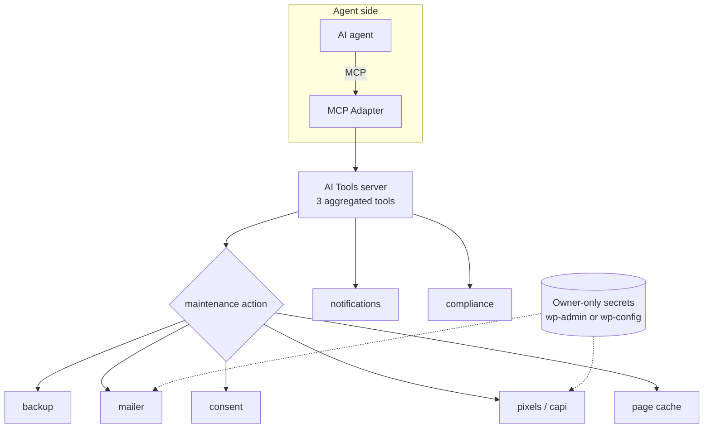

# AI Tools for WooCommerce — Store Infrastructure over MCP

  

**A WordPress plugin that replaces the pile of small utility plugins a WooCommerce store usually installs — and exposes them to an AI agent through MCP.**

Backups, API mail, cookie consent, consent-gated pixels with server-side conversion tracking, page cache, Merchant feed, login hardening, notification switches and a compliance toolkit — in one plugin, with one settings surface, and only 3 MCP tools to learn.

> 用内置代码替代店铺平时要装的一堆小插件（备份/邮件/同意/像素/缓存/feed/加固/合规），只暴露 3 个 MCP 工具。

---

## What it replaces

| Module | Replaces | Notes |
|---|---|---|
| `backup` | UpdraftPlus and similar | Database + uploads, verified archives, retention policy |
| `mailer` | WP Mail SMTP | Amazon SES / Mailgun / Postmark over API |
| `consent` | Cookie-consent plugins | Banner, CPRA / GPC handling |
| `pixels` + `capi` | Pixel and conversion plugins | Consent-gated ad pixels plus server-side Meta CAPI / TikTok Events API / GA4 Measurement Protocol |
| `page-cache` | WP Super Cache and similar | Optional, off by default |
| `feed` | Google Merchant feed plugins | Product catalog feed |
| `hardening` | Security-hardening plugins | Login hardening |
| `notifications` | — | Per-event email switches |
| `compliance` | Compliance plugins | Age gate, Prop 65, accessibility |

Fewer plugins means fewer update conflicts, one place to audit, and one settings screen instead of nine.

## Architecture



## Secrets never reach the agent

Mail API keys and the Meta CAPI / TikTok / GA4 tokens are set **only** by the store owner, in wp-admin (**WooCommerce → Hark Ads / Hark Mail**) or in `wp-config.php`. The MCP layer can read a single boolean — `key_set: true/false` — and nothing else. There is no tool that returns a key, and none that writes one.

## Quick start

**Requirements:** WordPress 6.9+, PHP 8.0+, the official [MCP Adapter](https://wordpress.org/plugins/mcp-adapter/) plugin. WooCommerce is needed for some modules.

```bash
wp plugin install mcp-adapter --activate
wp plugin activate ai-tools          # after copying this repo to wp-content/plugins/
wp mcp-adapter serve --server=ai-tools --user=<admin-account>
```

Remote HTTP endpoint: `https://<your-site>/wp-json/ai-tools/mcp` (application password).

### Verify in 60 seconds

```bash
# backups exist, are readable, and verify against their checksum
wp hark-store backup list
wp hark-store backup verify <name>
wp hark-store backup path

# mail is configured (key presence only, never the value)
wp hark-store mail ...
```

Then ask the agent to call `maintenance` with `action: backup_list` — the list must match what the CLI reports. A mismatch means the MCP adapter is serving a different user or site.

## Tools (3)

Three aggregated tools instead of a dozen thin ones — the agent picks an `action` inside each.

| Tool | Actions |
|---|---|
| `maintenance` | `backup_list` `backup_verify` `backup_run` (needs approval) `mail_status` `mail_log` `mail_test` `consent_status` `followup_status` `cache_status` `cache_purge` `ads_status` |
| `notifications` | Per-event email notification switches |
| `compliance` | Age gate, Prop 65, accessibility |

## CLI

```bash
wp hark-store backup [list|run|verify <name>|path|set <enabled|frequency|keep|uploads> <value>]
wp hark-store mail ...
```

## Deliberate limits

- **Backups cannot be deleted over MCP.** Only the retention policy removes them, and it always keeps at least one.
- Cache purging and backup runs are the only destructive-ish actions, and they are the two that require owner confirmation.

## Sibling plugins

| Repo | Role |
|---|---|
| [ai-hand](https://github.com/baibiaowang/ai-hand-for-woocommerce) | Store operations — the day-to-day work |
| [ai-design](https://github.com/baibiaowang/ai-design-for-woocommerce) | Storefront look |
| **ai-tools** (this repo) | Store infrastructure — what this plugin does |

All three share `hsm-core.php` and can be active together.

## Status

**v1.1.0 — development.** Verified against a local Docker store. **Not published on WordPress.org.** The module list is driven by what the store actually needed, so it is intentionally narrower than the plugins it replaces.

## License

GPL-2.0-or-later.
